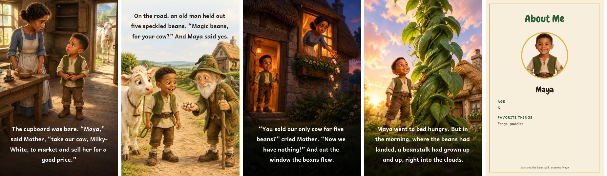

# Testing the storybook (pages 1–3 + About Me)

The homework-1 checks (likeness and scene fidelity on seven adult and child faces) are in [TESTING-homework1.md](TESTING-homework1.md).

For the book, three things have to hold:

1. **Same child on every page.** Jack's face, hair, glasses and clothes match across pages 1–3 and match the uploaded child.
2. **Faithful to the storyboard.** Each page shows what the brief describes, and its text zone stays empty so the printed text can be read.
3. **No text drawn by the model.** All text comes from the PDF layer.

## Method

- **Children.** Three synthetic children (no real kids): `child-1` (boy about 6, dark skin, curly hair, missing front tooth), `child-2` (girl about 7, East Asian, black bob, red glasses), and `face-2` (girl about 9, StyleGAN photo, light-brown hair). See `test-faces/`.
- **Pipeline.** Exactly what the app does: 1 reference call, then pages 1, 2, 3 in order, one call each.
- **Inputs per page.** Every page call is an **image edit** with the reference (image 1), the photo (image 2) and every earlier page (images 3+), so the mother, the cow, the cottage and Jack carry over. The style string `BOOK_STYLE` is identical in every call; `npm test` checks this.
- **Judging.** I viewed each book as one sheet (photo | reference | page 1 | page 2 | page 3) with the text zone outlined in red, and zoomed in on the page-2 beans. These are my own visual judgments, not a face-recognition score.
- **Offline tests.** `npm test` (17 tests, no key) covers the API rules, the same style string in every call, story text never sent to the model, earlier pages required, and the PDF building.

## Results: final setup (`gpt-image-2.5-flare`, low quality, earlier pages as references)

| Child | Same child on all pages | Matches the photo | Storyboard | Text zones clear | Notes |
|---|---|---|---|---|---|
| child-1 | yes | yes (curly hair, missing tooth) | yes | yes | Jack is small in the page-3 doorway, but still recognizable |
| child-2 | yes | yes (red glasses and bob on every page) | yes | yes | Best likeness of the three |
| face-2 | yes | **partly** | yes | yes | The reference came out younger and lighter, with blue-green eyes, and every page inherits that. The pages match each other, not quite the photo |

Storyboard details checked:

- **Page 1:** bare kitchen, empty shelves, the mother, Milky-White through the open door, Jack looking at his mother.
- **Page 2:** dirt road, Jack holding the cow's rope, the old man fully in frame with **exactly five beans**, one of each colour. Zoomed in on all three books: 5, 5, 5.
- **Page 3:** dusk, darker palette, the mother throwing beans from the window, Jack watching from the doorway.
- **Continuity:** the mother (bun, blue dress, apron) and the cow look the same on pages 1–3 in all three books.

Sheets: [child-1](test-results/thumbs/book-child-1.jpg), [child-2](test-results/thumbs/book-child-2.jpg), [face-2](test-results/thumbs/book-face-2.jpg), [beans close-up](test-results/thumbs/book-beans-f2.jpg), [sample PDF pages](test-results/thumbs/book-sample-pdf.jpg).

## The edit endpoint ("same scene, one thing changed")

On child-2's page 3 I asked for one change: "make the five falling beans glow softly so they stand out against the dusk". The edit changed only the beans. The mother, Jack, the doorway, the lighting and the empty grass zone stayed the same. [Before and after](test-results/thumbs/book-fix-test.jpg).

## Iteration log

| Round | Setup | What I saw | Change made |
|---|---|---|---|
| 1 | `gpt-image-1.5`, medium; each page made from reference + photo only | Jack was consistent, but page 2 had about 8 beans and the old man was cut off at the edge. Jack's legs ran into the bottom text zone on pages 1 and 3. Nothing tied the mother or cow on one page to the next. [Round 1 sheet](test-results/thumbs/book-child-1-round1.jpg) | Said "exactly FIVE beans, no more and no fewer, one of each colour" and "the old man is fully inside the picture". Gave exact framing: feet two-thirds down, and nothing but floor or grass in the bottom third. |
| 2 | Same prompts, plus every earlier page passed into the edit call for continuity | Not run on 1.5: switched to a cheaper model before any round-2 page was made | Model changed to `gpt-image-2.5-flare`, low quality |
| final | `gpt-image-2.5-flare`, low, chained pages | Results in the table above: all three pass consistency and storyboard, face-2 only partly matches the photo | None yet. See to-do.md |

Two other findings:

- **`gpt-image-1` was retired.** It returns "model does not exist", even though it's still listed for the key. The previous default stopped working on its own.
- **Flare at low quality is about 2x faster** (10–20 s per image) and cheaper. At this quality it looked as good as or better than 1.5 at medium for this style.

## Live site

I ran one full book on https://beanstalk.eliweiss.me through its public API, the same calls the UI makes: reference 10 s, pages 11–14 s each, PDF 2 s. That's about 50 s in total for child-1. The PDF came back as `JackAndTheBeanstalk.pdf` with 4 pages (this is the submitted sample, `samples/JackAndTheBeanstalk.pdf`, for "Theo"): same child and mother throughout, text in the clear zones, About Me last.

## Not tested

- **Playground.** Prompts were iterated by script and visual review, not in the OpenAI Playground.
- **Real children's photos.** Only synthetic faces were used.
- **Phones.** The UI and the PDF download were checked in desktop and mobile-width browsers only, not on real phones.

## Homework 3: parallel generation, sign-in and storage

### Parallel pipeline (real API, `gpt-image-2.5-flare`, low)

Two real books were run through the new server pipeline:

1. Sign in, then `POST /api/books`.
2. Round 1, in parallel: the reference and the cast sheet.
3. Round 2, in parallel: all 3 pages.

| Child | Round 1 (reference + cast) | Round 2 (3 pages) | Total | Result |
|---|---|---|---|---|
| child-1 | 11–13 s | 13–14 s | **28 s** | Pages 1–2 fine. Page 3 was **blocked by the safety filter**. |
| child-2 | 13 s | 11–15 s | **28 s** | All 5 fine: red glasses and bob on every page, the same mother, cow and old man throughout |

The old chained pipeline took about 50 s for the same book. Sheets: [child-1](test-results/thumbs/hw3-parallel-child-1.jpg), [child-2](test-results/thumbs/hw3-parallel-child-2.jpg).

**The page-3 block.** I ran one diagnostic call per change:

1. Softening the wording from "angrily flinging" to "a cross, disappointed frown, tossing": **still blocked**.
2. The same page without the child's real photo (only the reference and the cast sheet): **passed**. Jack was larger and clearly recognizable, all five beans were in flight, and it was dusk.

Pages 1 and 2 had passed with the photo attached, so the photo isn't always blocked. But the photo plus a dark scene with an upset adult was enough to trip the filter.

**Change:** page calls now send only the reference and the cast sheet. The child-2 book above was made that way, and its likeness held.

### Sign-in, storage and progress (mock images, no cost)

- **`npm test`: 23 offline tests** with mock images and an in-memory Postgres (PGlite). They check that:
  - book routes need sign-in
  - Jack and the cast start together, and the pages start only after both finish
  - the 3 pages overlap in time (parallel)
  - pictures are served only to their owner
  - the PDF needs a name and builds without a model call
  - fix keeps the old page and Undo restores it
  - a failed picture keeps its old image and shows the reason, with no retry
  - deleting removes the book
- **Browser, mock mode:**
  - Dev sign-in, upload, then "Make my book".
  - The progress panel showed one bar per picture: "Drawing… about 14 s left" for Jack and the cast, "Waiting" for the pages, then "Done" row by row and "All 5 pictures ready".
  - About me autosaved, and the PDF downloaded as `Theo-JackAndTheBeanstalk.pdf`.
  - After a reload, the book and its name were still there under My books.
  - The layout was checked at desktop and 375 px phone width; no console errors.
- **Not tested yet:**
  - real Google sign-in end to end (the client ID is accepted by Google; signing in needs a real account on a registered address)
  - the deployed version

### Neon database (real, mock images)

With the real `DATABASE_URL` in `.env`, I signed in with dev login, made a book with mock images, set a name, and restarted the server. After the restart, the same book was listed with all its pictures and name, and the session cookie still worked. The test book was then deleted.

### Story rewrite after the feedback (real API, `gpt-image-2.5-flare`, low)

Changes from the human and AI feedback:

- The text explains why Mother throws the beans out.
- A fourth page shows the beanstalk the next morning.
- The child's name is in the text.
- "their cow, Milky-White" is said the first time.
- The beans are speckled instead of five bright colours.

Test on child-1 (`TRY_TAG=f3`), reusing the earlier reference and page 1:

| Picture | Time | Result |
|---|---|---|
| Cast sheet | 16 s | Old man holds speckled cream and plum beans |
| Page 2, the trade | 14 s | First try: the old man's hat reached the top text zone, and the longer text ran over it. Shortened the text and added "every head, including the top of the old man's hat, stays below the top third". The redraw is clean. |
| Page 3, the window | 13 s | Speckled beans fall from the window. Not blocked. |
| Page 4, the beanstalk | 12 s | Jack at the foot of a huge beanstalk at sunrise, with the cottage beside it |

In the browser (mock images): typing a name updates all four page texts at once, the progress panel shows "All 6 pictures ready", and the PDF downloads.

---

# Homework 4: the 20-page book, money and the quality loop (2026-11-15)

## Automated

`npm test` runs 39 offline tests (no key, no database, no network; mock images, mock checks, simulated checkout). They cover: the template serving both stories, text length and name use, every prompt (style string, no story text, clear zone), the quality loop (pass first time, redraw with the reason, 3 at most, best kept, deadline), the pass rules of the picture check, the text layout (never on a face, middle when top and bottom are taken, under the art when nothing is clear, tone from brightness), the cost maths, funding credited exactly once, $0.99 per book, attempt counts per picture, every call in the cost log, owner-only pictures, the stored PDF after signing in again (21 pages), refund request and processing, and the transaction history.

## Pre-made pictures

`scripts/pregen.mjs` drew 13 bible pictures and 40 scenes with `gpt-image-2.5-flare` at low quality. All 53 passed the check on the first drawing. Total cost $1.14. On 37 of 40 scenes the text sits where the template planned; on 3 the layout step moved it.

## Real books (`scripts/make-book.mjs`)

| Run | Photo | Story | Photo to PDF | Drawings | Redraws | Cost | Sheet |
|---|---|---|---|---|---|---|---|
| 1 | `test-faces/child-1.jpg` | Jack and the Beanstalk | 29.3 s | 21 | 0 | $0.59 | [pages](test-results/thumbs/hw4-jack-child-1.jpg), [PDF pages](test-results/thumbs/hw4-jack-pdf-pages.jpg) |
| 2 | `test-faces/child-2.jpg` | Little Red Riding Hood | 55.5 s | 18 (+3 template pages) | 0 | $0.33 | [pages](test-results/thumbs/hw4-red-child-2.jpg), [PDF pages](test-results/thumbs/hw4-red-pdf-pages.jpg) |

- Run 1 sent the scene at 1024 px and the reference at 768 px. A one-page test at 640 px and 384 px gave the same quality for about a third less, so run 2 used those sizes.
- Run 2 was slow because one image call (page 19) took 45 s while the others took 13 to 18 s. A backup call after 21 s was added afterwards.
- The child is recognisably the same on every page of both books, glasses included in run 2.
- In run 2 the layout step found no clear band on pages 12, 16 and 18 and used the framed layout (art in a frame, text under it).

## Stripe sandbox, by hand

Local server with the real sandbox key: paid $5.00 on Stripe's page with the test card, came back with the balance at $5.00; made a book (balance $4.01); requested and processed a refund of $4.01 (Stripe refund id returned, balance $0.00). The history showed all three rows with their causes.

---

# Homework 5: print and ship (2026-11-17)

`npm test`: 47 offline tests. New ones cover the cover slot, the name and About Me checks (rules layer), the print interior (24 pages, 6.25 × 9.25 in) and case-wrap cover (1008 × 774 pt), approval voided by a change, field-by-field address errors, a paid order sent to the (simulated) printer with its ledger lines and secret file links, and an automatic refund when the print files can't be built.

Real run: `scripts/make-book.mjs test-faces/child-2.jpg red Maya` made a 24-page book in 31 s for $0.34 of API calls, the cover included. [Pages](test-results/thumbs/hw5-red-pdf-pages.jpg), [contact sheet](test-results/thumbs/hw5-red-sheet.jpg), [PDF](samples/Maya-LittleRedRidingHood.pdf).

A Jack and the Beanstalk run started at the same time hit the OpenAI rate limit (four pages failed); a rerun failed because the account ran out of credit.
